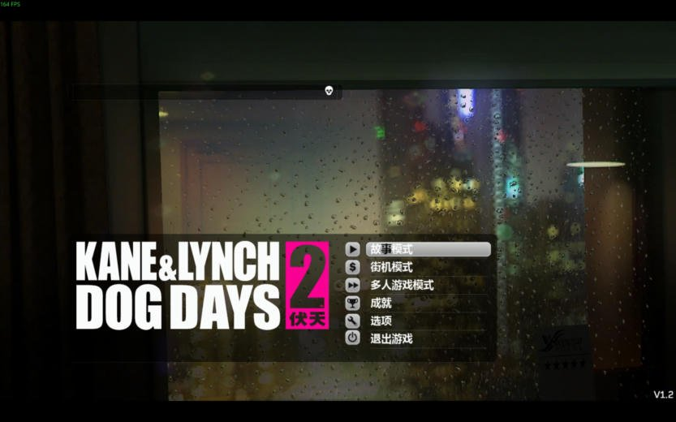
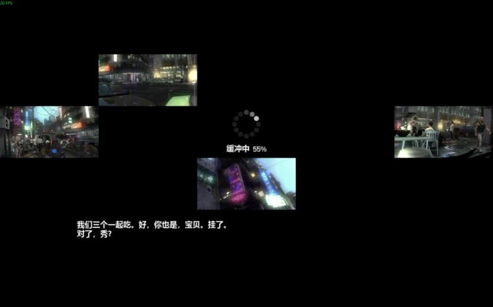
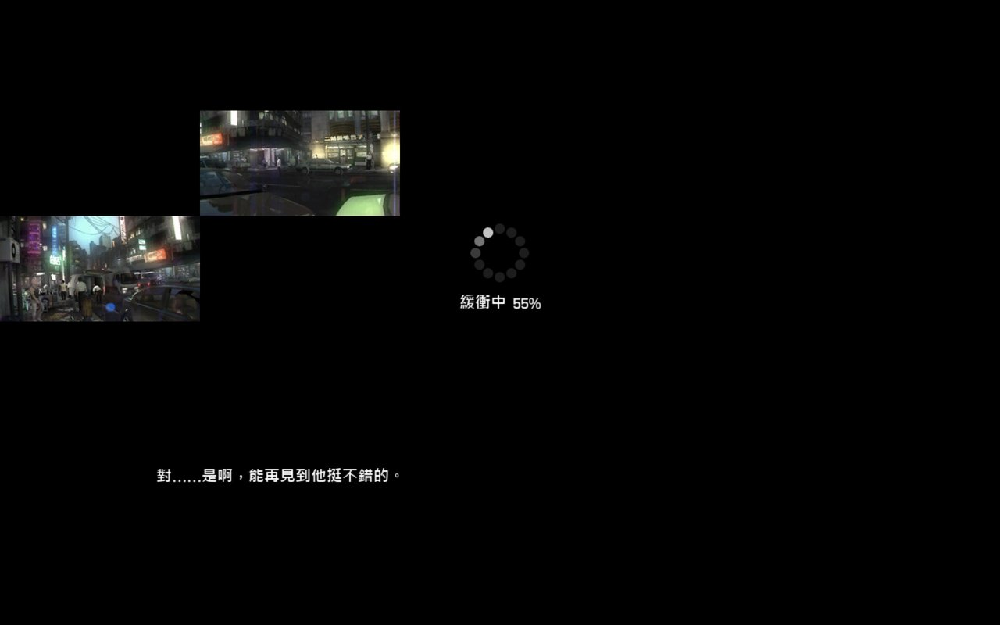
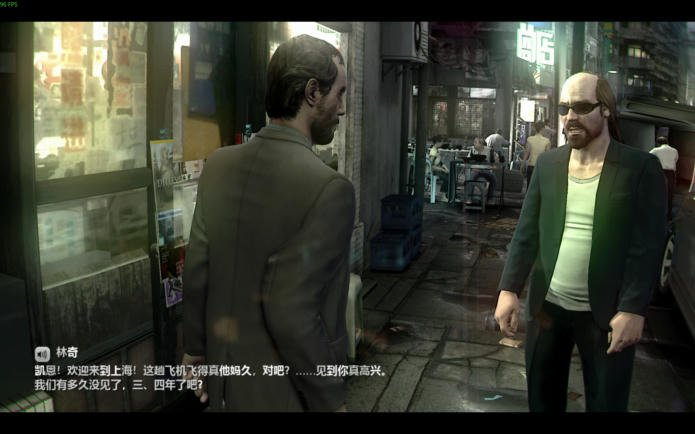
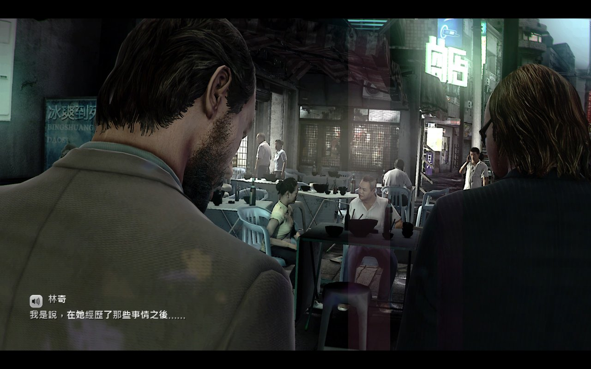
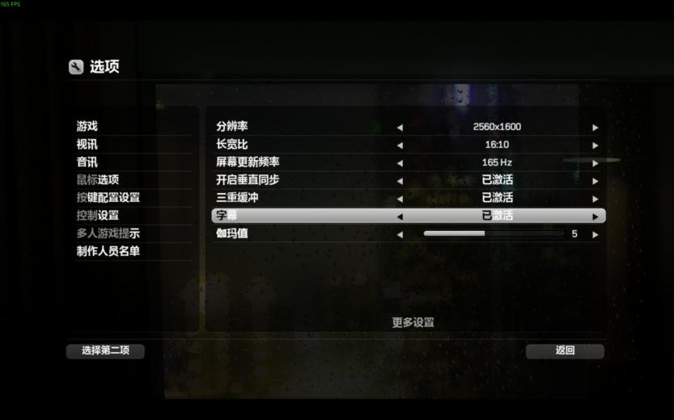
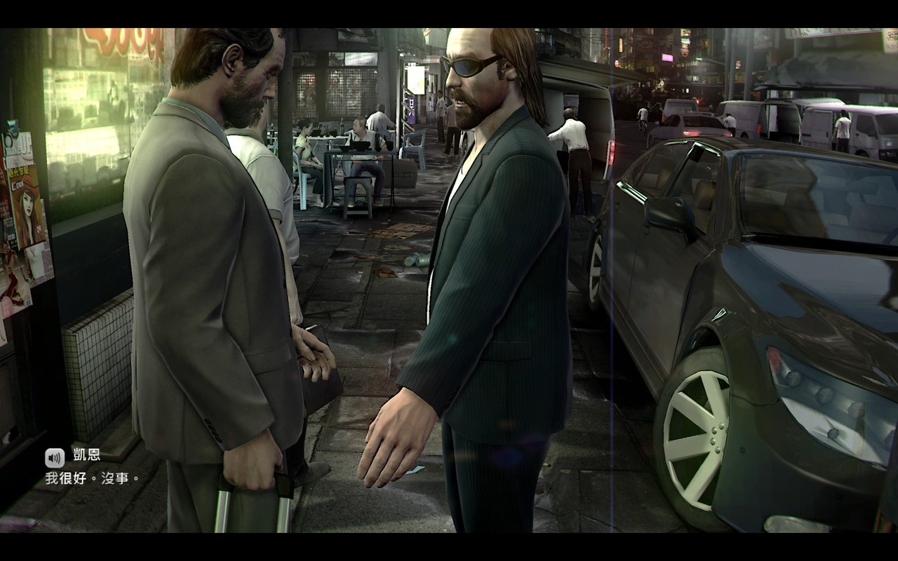

# 《Kane & Lynch 2: Dog Days》凯恩与林奇2：伏天 中文化补丁（简体／繁体，单人模式）

对应 Steam 版。一键安装、一键还原，不用装任何软件。另附「启动闪退＋存档修正」。

**[⬇ 点这里到 Releases 下载 KaneLynch2_zh_v1.0.zip（约 61 MB）](https://github.com/toBerlinWay/KaneLynch2-zh/releases/latest)**

> 请从 Releases 下载 zip。直接点绿色 Code → Download ZIP 下载到的只有安装脚本，没有补丁文件，装不了。

zip 里有三个文件夹，按需要使用：

| 文件夹 | 内容 |
|---|---|
| `KaneLynch2_简体中文补丁_v1.0` | 简体中文（大陆用语） |
| `KaneLynch2_繁體中文補丁_v1.0` | 繁体中文（台湾用语） |
| `KL2_啟動閃退修正_v1.1` | 启动闪退＋存档修正（和汉化无关，原版也会遇到） |

## 转载说明

- **这是完整的单人模式汉化**：菜单、选项、操作提示、全部单人关卡的对白字幕、加载画面的电话字幕都已中文化，共 3,628 句。多人模式没有翻译。
- **全部文字已进行口语化精翻**：按角色语气润色，保留原作的粗口和街头口吻；简体用大陆说法，繁体用台湾说法。
- **官方没有中文，网上也没有现成的汉化。文字和字体全部重新制作，没有使用任何旧汉化的内容，纯属个人作品。**
- 欢迎其他社区、论坛、群组转载分享（建议附上本页链接，方便大家拿到最新版）。
- **禁止其乐社区（Keylol）及其附属社区、群组与团体转载。** 不论是转贴文件、搬运到其他网盘、重新打包，还是只转贴下载链接，一律禁止；以个人名义代为转载也一样。

## 安装

1. 关闭游戏。
2. 解压 zip，进入 `KaneLynch2_简体中文补丁_v1.0` 双击 `安装简体中文.bat`（繁体：进入 `KaneLynch2_繁體中文補丁_v1.0` 双击 `安裝繁體中文.bat`）。大约 2～5 分钟，看到「安裝完成」就好。
3. 游戏语言保持 English 即可。第一次进游戏请到「选项 → 视讯 → 字幕」把字幕打开。
4. 如果提示找不到游戏文件夹，把游戏文件夹路径粘贴进去（里面要有 kl2.exe），或者把补丁文件夹放进游戏目录（Steam 库里右键游戏 → 管理 → 浏览本地文件）再运行一次。

简体、繁体随时可以互换，直接安装另一个就好。

**还原英文**：双击 `卸载简体中文.bat`（或 `移除繁體中文.bat`），所有改过的文件都会恢复原状。

## 一启动就闪退？每次都说「找不到存档」？

这两个问题和汉化无关，原版游戏也会发生。进入 `KL2_啟動閃退修正_v1.1` 双击 `安裝閃退修正.bat` 就能一次修好：

- **闪退**：游戏没有用 Windows Live，只用 Steam。但它启动时会连接 Eidos 早已关闭的服务器，电脑开着系统代理（VPN、加速器、Clash 等）时，会在「Buffering」时闪退。修正会让游戏不读系统代理，并在 hosts 把那个服务器指到本机（需要管理员权限，Windows 会弹出询问）。
- **存不了档**：「文档」文件夹的路径有中文（例如 `OneDrive\文档`）时，这款老游戏读不到路径，进度和字幕设置都存不下来，每次都提示「找不到存档」。修正会把存档改放到 `AppData\Local\Square Enix`。「文档」路径正常的电脑不会改这一项。

两项各只改 kl2.exe 的 1 个字节，原文件会备份；双击 `移除閃退修正.bat` 即可还原。

## 截图

| 简体版 | 繁体版 |
|---|---|
|  |  |
|  |  |
|  |  |
|  |  |

更多简体版实测画面：[docs/overview_cn.jpg](docs/overview_cn.jpg)

## 注意事项

- 只对应 Steam 版。补丁会先逐个用 SHA-256 校验游戏文件，不符合就直接拒绝，不会弄坏游戏。
- Steam 验证游戏文件或游戏更新后会变回英文，重新安装一次即可。
- 补丁包是差分文件：不含游戏的模型、音效和视频，只含改过的文字和新增的中文字体页，必须有正版原文件才能安装。
- 安装脚本是纯 PowerShell（Windows 10/11 自带），不联网，也只会改游戏文件夹里的文件（闪退修正另外会改 hosts）。源码在 [`source/`](source/)，可以用记事本打开检查。杀毒软件如果提示，是因为 .bat 会调用 PowerShell 脚本。
- 安装窗口里的提示文字是繁体字，不影响使用。
- 语音是英文，字幕是中文。多人模式保持英文。

## 已知问题

- 简体版少数用词还带台湾口吻（例如选项里的「视讯」「音讯」）。
- 免责声明画面在「凯恩与林奇」后面就换行（游戏会优先在空格处换行）。

## 技术说明（给好奇的人）

- 文字在每个场景封包的 `*English.LOC`（UTF-8 树状格式）里，直接替换英文。
- 游戏用自带的位图字体：把用到的汉字（简体 1,562 字、繁体 1,603 字）画成新的 512×512 字体页加进各场景的贴图包，再更新字符表（.prm）和贴图尺寸表（.hti）。
- 加载画面的字幕脚本是用「文件内的字节位置」找字体的；字体变大、搬到文件末尾后，这个位置要跟着改，否则新字全部变成空白。
- 大文件包只在文件末尾追加数据，原本的字节完全不动；卸载就是截回原长度并核对 SHA-256。补丁包只带差异数据，安装时用玩家自己的原版文件重建。

## 繁體中文說明

見 [說明_繁體.txt](說明_繁體.txt)。简体完整说明见 [说明_简体.txt](说明_简体.txt)。

## 致谢与授权

- 游戏《Kane & Lynch 2: Dog Days》版权归 IO Interactive 与 Square Enix 所有。本补丁为非官方玩家作品，请支持正版。
- 翻译：Antigravity（Gemini）。字体、工具与测试：Claude（AI）。
- 中文字体页由微软雅黑／微软正黑体渲染成位图。
